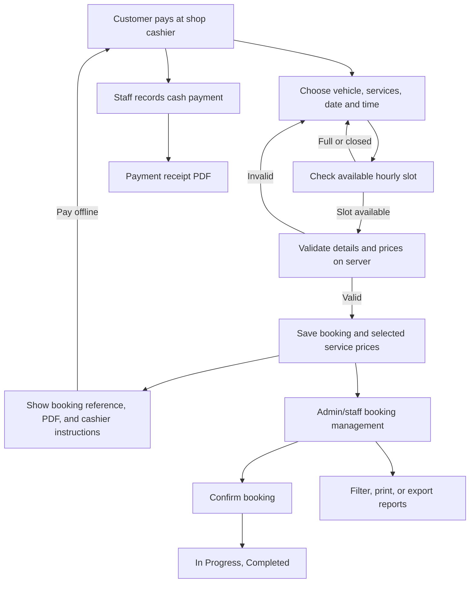
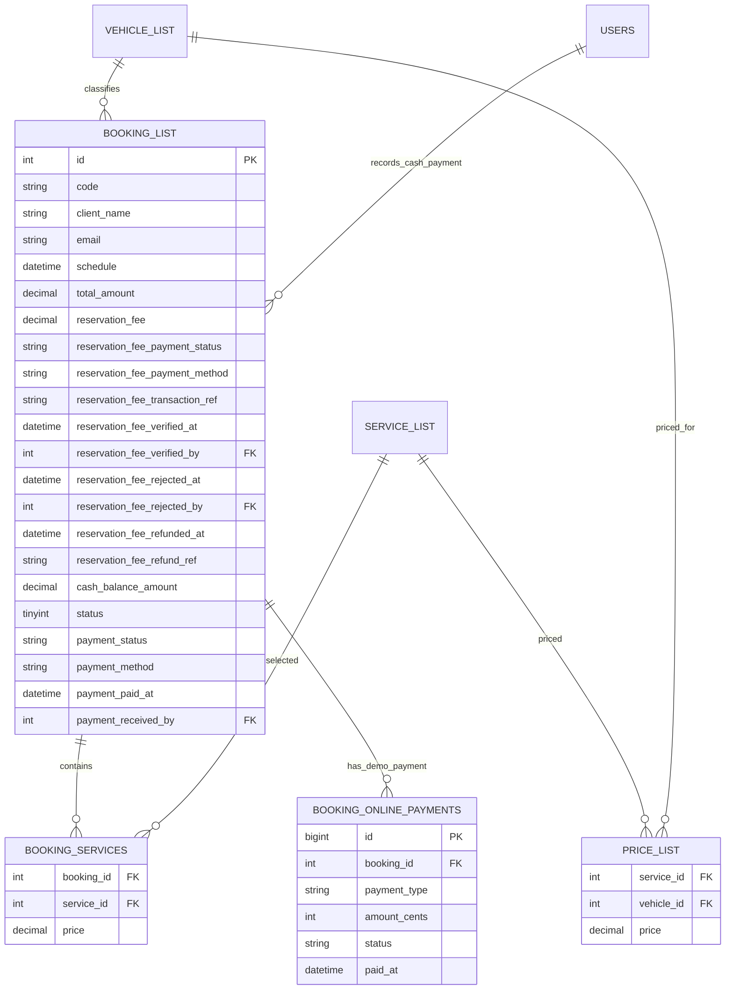

# Online Car Wash Booking System — Defense Guide

## System overview

The system lets customers book car-wash services by vehicle type, select an appointment, and receive a booking-confirmation PDF. A PHP 250 reservation fee is added to the selected-services subtotal. Customers pay the full amount offline at the shop cashier, and bookings remain unpaid until staff records the payment. Staff can manage bookings, record cash payments, issue receipts, and print or export date-filtered reports. The public booking lookup is not available.

### Technology and deployment

- PHP application with MySQL/MariaDB storage
- Runs locally with Apache and MariaDB (for example, XAMPP)
- PHP sessions for staff authentication
- Browser UI built on the existing Bootstrap/AdminLTE application
- PDFs are generated by the application; all new customer payments are made offline at the shop cashier
- New bookings remain unpaid until an administrator or staff member records the cash payment
- Online payment submissions are disabled; historical online-payment data is retained for existing records

## Booking rules

- Shop hours: Monday–Friday, 7:00 AM–11:00 PM; Saturday–Sunday, 7:00 AM–12:00 AM Philippine local time
- Appointment start times: every hour from 7:00 AM during shop hours; last starts are 10:00 PM weekdays and 11:00 PM weekends
- Capacity: at most two non-cancelled bookings per start time
- The shop is open every day; weekday and weekend hours differ
- A PHP 250 reservation fee is included in the booking total
- Customers pay the full amount at the cashier; reservation-fee-only payment is not available
- Payment automatically confirms bookings; paid bookings move to In Progress in appointment order when their scheduled time arrives and the previous active booking is Completed. Customer-facing estimates show service duration ranges; the maximum of each range is used for automatic completion. After the sum of selected service maximums elapses from In Progress, the booking is automatically marked Completed.
- Cancelled bookings no longer consume appointment capacity
- Legacy payment-review columns and demo-payment records are retained for historical records; new bookings include the fee in the total and are marked paid only when staff records the cash payment

## System flow

## Database overview

## Manual acceptance-test checklist

Earlier local checks were run against the XAMPP/MariaDB installation on October 26, 2026, before the latest customer lookup and payment changes. Retest the booking and offline cashier flow on the actual defense computer and attach screenshots or a screen recording; previous checks do not validate these changes and local checks are not a substitute for panel-approved user evaluation.

| ID | Scenario | Steps | Expected result | Actual result / evidence |
|---|---|---|---|---|
| AT-01 | Valid booking | Choose an active vehicle, one or more services, a future weekday slot, and valid customer details; submit | Booking saves once, server-calculated prices plus the PHP 250 reservation fee appear, and confirmation PDF opens | **Not yet run after this change.** |
| AT-02 | Tampered price | Change a posted service price in browser tools before submitting | Server ignores the posted price and uses the active database price | **Not yet run after this change.** |
| AT-03 | Invalid/past appointment | Submit a past date or time, a Sunday, outside shop hours, or a time not on the hourly opening-time boundary | Request is rejected with a clear validation message | **PASS locally:** past date, Sunday, outside-hours time, and off-interval time were rejected. |
| AT-04 | Slot capacity | Create two bookings at one future slot, then attempt a third | First two succeed; third is rejected as full; the UI reports no remaining spots | **PASS locally:** full slot showed no spots and rejected a third booking; browser rendered available 12-hour options. |
| AT-05 | Cancelled slot | Cancel one booking in a full future slot and refresh availability | One spot becomes available | **PASS locally:** cancelling one temporary test booking restored one spot. Test rows removed. |
| AT-06 | Offline cashier payment | Create a booking, inspect the confirmation, and record payment as staff | Confirmation instructs the customer to pay at the shop; booking remains unpaid until staff records the cash payment | **Not yet run after this change.** |
| AT-07 | Automatic paid booking queue and completion | Pay two bookings in appointment order; set each service duration to 1 minute for the test; wait until their schedules | The first paid booking automatically enters In Progress and becomes Completed after its service duration; the next then enters In Progress without staff changing its status | **Not yet run after this change.** |
| AT-08 | Online payment disabled | Submit a GCash/Maya reference to the former payment endpoint | Request is rejected; no payment record is created and booking remains unpaid | **Not yet run after this change.** |
| AT-09 | Public lookup removed | Open the former customer lookup URL and inspect the public navigation | No public booking lookup is available; transfer references require the booking confirmation token | **Not yet run after this change.** |
| AT-10 | Date-range report | Filter a date range by booking date and appointment date; print and export each CSV | Both filter modes show expected bookings and payment totals; CSV can be exported | **Not yet run after this change.** |
| AT-11 | Authorization | Open the CSV export while logged out and attempt a status update as a non-staff user | Export/status update is denied; no booking data or status is changed | **PASS locally:** anonymous CSV export and unauthenticated status update were denied. |

### Local verification summary

- Earlier PHP syntax checks and browser checks passed before the current removal changes.
- Retest service duration estimates and maximum-based auto-completion, the PHP 250 fee, confirmation PDF, offline cashier payment recording and receipt, reports, and absence of the public lookup route.
- Legacy reservation-fee fields and records remain in the database for older bookings; new bookings do not use that workflow.
- Customer notification dismissals are saved in the database so dismissed booking cards stay removed when navigating away and returning. Apply `database/add_customer_booking_dismissals.sql` once on existing databases.
- The appointment index migration and `update_service_durations_to_max_estimates.sql` must be applied to an existing local database without deleting existing bookings. The service-duration migration updates current service defaults but does not change duration snapshots on existing bookings. Online-payment migrations are needed only to preserve/review historical online-payment records. The SMS verification table is not used.
- **Still to do in person:** open the print dialog on the defense computer, capture screenshots of the actual system screens, verify the final presentation/database backup, and add any school-required user-evaluation results. No user-evaluation scores have been assumed or fabricated.

### Evidence to prepare for the panel

- Screenshot of the customer booking form, available slots, confirmation, and cash payment receipt
- Screenshot of staff booking management and cash payment recording
- Screenshot of a filtered report and its CSV opened in a spreadsheet
- Completed acceptance-test checklist with actual outcomes
- ERD and system flow above (render Mermaid diagrams or recreate them in the presentation tool)
- A clean demo database and a backup copy before the live presentation

## Presentation

`DEFENSE_PRESENTATION.html` is a self-contained, nine-slide presentation template. Open it in a browser and use **Print / Save as PDF** to produce a PDF copy. Replace the clearly marked school/student/adviser and research-result placeholders with approved information before presenting; do not claim unrun user evaluations.

## Database setup note

Import `database/ocwbs_db.sql` for a new installation. For an existing installation, apply each required SQL migration only if its fields/indexes are not already present; migration scripts are not intended to be applied repeatedly. Apply `database/update_vehicle_types.sql` to replace the vehicle catalog and copy Sedan pricing to the new vehicle types. Apply `database/add_booking_schedule_index.sql` once for the slot-availability query, `database/add_service_durations_and_auto_completion.sql` once for service duration and automatic completion, `database/update_service_durations_to_max_estimates.sql` once to set the service estimate maximums, and `database/add_customer_booking_dismissals.sql` once to persist dismissed booking cards.

Before a public deployment, replace demo accounts, set strong staff passwords, configure HTTPS, and protect database backups and customer contact data. The system does not send email or SMS notifications.
